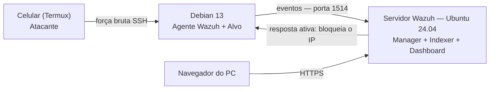

# Mini-SOC caseiro com Wazuh

Laboratório defensivo (Blue Team) montado do zero para **detectar, responder e documentar ataques reais** contra as minhas próprias máquinas, usando o Wazuh como SIEM + XDR. Todo o processo está versionado e documentado neste repositório.

## Resultados em destaque

- 🔎 **Gestão de vulnerabilidades:** de **7.135 para 352** vulnerabilidades detectadas (**−95%**) após aplicação de patches, com baseline antes/depois registrada.
- 🚨 **Incidente de força bruta SSH** detectado, **bloqueado automaticamente** (resposta ativa) **8 segundos** após a primeira tentativa errada e revertido, com relatório no modelo **NIST SP 800-61**.
- 🛡️ **Hardening (CIS Benchmark):** nota do Debian de **38% para 43%**, com as decisões de escopo documentadas.

## Arquitetura do lab



- **Servidor Wazuh 4.14** (all-in-one) numa VM Ubuntu Server 24.04, no VirtualBox.
- **Debian 13** físico (notebook headless) como endpoint monitorado e alvo dos ataques.
- **Celulares com Termux** como atacantes (reconhecimento e força bruta via `nmap`).
- Rede em **modo bridge**, para que todos se enxerguem na mesma faixa de IP.


## Habilidades demonstradas

| Área | No projeto |
|---|---|
| SIEM / XDR | Deploy do Wazuh, agentes, regras e dashboards |
| Leitura e análise de logs | Eventos de autenticação SSH (journald), triagem de alertas |
| Resposta a incidentes | Resposta ativa (bloqueio de IP) e relatório NIST SP 800-61 |
| Playbooks / runbooks | Procedimentos documentados em `docs/` |
| Gestão de vulnerabilidades | Detecção de CVE, patch e validação com baseline antes/depois |
| MITRE ATT&CK | Mapeamento do ataque (T1110 — Brute Force) |
| Hardening | CIS Benchmark via SCA, com nota antes/depois |
| Linux | Debian e Ubuntu Server, rede, systemd, journald |
| Documentação e versionamento | Markdown + histórico Git por entrega |

## Estrutura do repositório

```
.
├── docs/                          # runbooks, relatório de incidente, playbook, hardening
├── configs/                       # configurações reais aplicadas (sshd_config, resposta ativa)
└── evidencias/                    # prints e CSVs que comprovam cada etapa
    ├── vulnerabilidades/          # painel de vulnerabilidades antes/depois dos patches
    ├── incidente-ssh-bruteforce/  # prints do ataque de força bruta SSH
    └── sca-hardening/             # exportações do SCA (CIS)
```

## Documentação

1. [Instalação do servidor Wazuh](docs/01-instalacao-wazuh.md)
2. [Agente Wazuh no Debian](docs/02-agente-debian.md)
3. [Relatório de incidente — força bruta SSH](docs/03-relatorio-forca-bruta-ssh.md)
4. [Playbook de resposta a força bruta SSH](docs/04-playbook-forca-bruta-ssh.md)
5. [Hardening do Debian](docs/05-hardening-debian.md)

## Fases do projeto

**Fase 1 — Operação de SOC (concluída)**
Wazuh no ar, agentes no Debian, simulação de ataque de força bruta SSH, detecção, resposta ativa, relatório de incidente, playbook e hardening medido.

**Fase 2 — Blue Team avançado (Em construção)**
Script Python de priorização de vulnerabilidades por CVSS/EPSS/CISA KEV, mapa MITRE ATT&CK Navigator, automação com n8n e enriquecimento de IoCs (VirusTotal/AbuseIPDB).

## Próximos passos

- Endpoint **Windows** com Sysmon + agente + testes do Atomic Red Team.
- Autenticação SSH **só por chave** (desabilitar senha) no Debian.
- Fase 2 completa (script de priorização de CVE + automação).