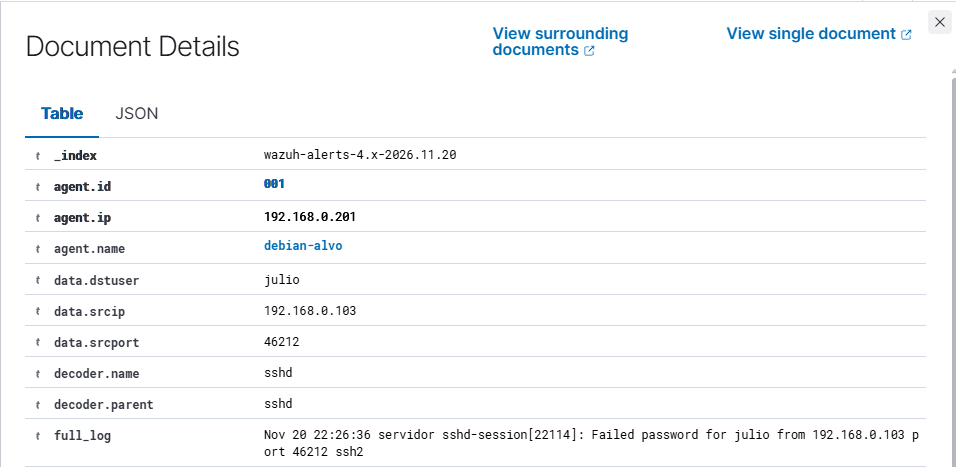
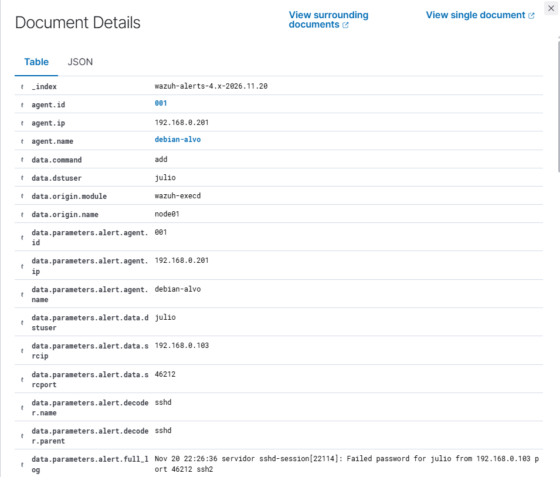
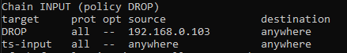
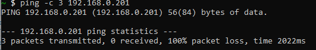
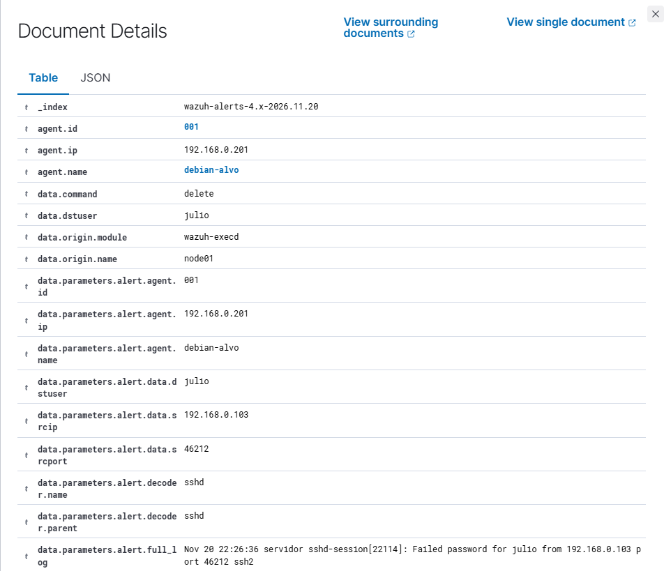

# Relatório de Incidente — Força Bruta SSH

## Resumo executivo

Um invasor (192.168.0.103) tentou acessar via SSH o usuário julio utilizando o método de força bruta. Após a 8ª tentativa de senha malsucedida dentro de 120 segundos, o bloqueio configurado foi ativado corretamente e o ataque foi parado. O IP do atacante foi desbloqueado após 180 segundos, conforme a configuração.

## Classificação

- **Tipo de incidente:** Tentativa de acesso não autorizado via SSH pelo método de força bruta
- **Severidade:** Média - tentativa de intrusão, mas contida automaticamente. SSH exposto na rede
- **Data e hora da detecção:** 20/11/2026, 19:26:38 (horário de Brasília, UTC−3)
- **Ativo afetado:** debian-alvo
- **Origem do ataque:** 192.168.0.103
- **Status:** Resolvido

## 1. Preparação

Wazuh all-in-one configurado e vigiando, via agente, o host debian-alvo, que coletava os logs do SSH pelo journald. Além disso, estavam ativas as regras padrão do Wazuh para força bruta (5760 e 5763) e a resposta ativa firewall-drop, configurada por mim.

## 2. Detecção e Análise

### Como foi detectado

Primeiro foi detectada uma falha de senha, indicada pela regra 5760, que, isolada, não quer dizer muito: pode ser apenas que o usuário tenha esquecido a senha ou digitado errado. Entretanto, quando várias senhas erradas são digitadas em um curto espaço de tempo (120 segundos), temos um padrão de ataque, identificado pela regra 5763.

### Linha do tempo (20/11/2026, horário de Brasília, UTC−3)

| Horário (UTC−3) | Evento                                                    |
| --------------- | --------------------------------------------------------- |
| 19:26:32.209    | Primeira tentativa de login malsucedida (rule 5760)       |
| 19:26:38.193    | Regra de força bruta dispara (rule 5763)                  |
| 19:26:40.185    | Resposta ativa bloqueia o IP (firewall-drop: add)         |
| 19:29:40.243    | Bloqueio removido automaticamente (firewall-drop: delete) |

### Indicadores de Comprometimento (IoCs)

| Indicador               | Valor         |
| ----------------------- | ------------- |
| IP de origem (atacante) | 192.168.0.103 |
| Usuário-alvo            | julio         |
| Porta / serviço         | ssh           |
| Técnica MITRE ATT&CK    | T1110         |

### Análise

O atacante tentou o acesso por força bruta, ou seja, utilizando várias senhas consideradas comuns num curto espaço de tempo, com o objetivo de acessar o host. O ataque foi malsucedido devido à resposta ativa do Wazuh, configurada por mim diretamente no arquivo ossec.conf, que bloqueia automaticamente o IP do atacante após várias tentativas em um espaço muito curto de tempo (8 tentativas seguidas em menos de 120 segundos).

## 3. Contenção, Erradicação e Recuperação

### Contenção

O Wazuh, via agente no host, criou uma regra DROP no iptables, e assim aquele IP específico ficou bloqueado diretamente pelo host.

### Erradicação e Recuperação

Como se trata de um laboratório, o ataque foi simulado por mim com outro aparelho, e as senhas eram propositalmente erradas. Por isso, não houve nada a erradicar ou recuperar. O acesso legítimo foi restaurado após o timeout configurado (180 segundos).

## 4. Atividade Pós-Incidente (Lições Aprendidas)

### O que funcionou

A detecção automática do ruleset padrão funcionou dentro do esperado.

### Recomendações

1. Desabilitar o login do root
2. Banir o IP no firewall por um tempo mais longo, ou até permanentemente
3. Utilizar chaves em vez de senhas
4. Reduzir a autoridade dos usuários apenas ao necessário, diminuindo as possibilidades de comprometer o sistema inteiro
5. Autenticação em 2 etapas

## Evidências

Detecção do ataque de força bruta

Adicionado o IP no DROP do iptables via Wazuh

Tentativa de pingar o IP do host pelo atacante, provando que a conexão foi cortada

Removido o IP do iptables via Wazuh

## Referências

- https://documentation.wazuh.com/current/user-manual/capabilities/active-response/ar-use-cases/blocking-ssh-brute-force.html
- https://csrc.nist.gov/pubs/sp/800/61/r3/final
