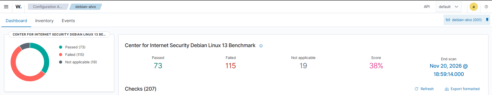
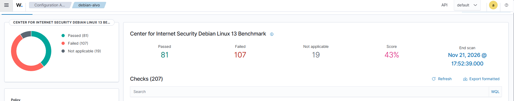

# Hardening do Debian

## Objetivo

Endurecer o Debian e medir os resultados com o SCA (Security Configuration Assessment) do Wazuh.

## Alterações

### SSH (`/etc/ssh/sshd_config`)

1. **PermitRootLogin no** — impede o login direto como root; obriga a entrar com um usuário comum e só então elevar privilégios.
2. **MaxAuthTries 4** — limita as tentativas de autenticação por conexão, dificultando a força bruta que sofremos no incidente.
3. **LoginGraceTime 1m** — reduz a janela em que uma conexão fica aberta sem autenticar.
4. **MaxStartups 10:30:60** — limita as conexões simultâneas ainda não autenticadas, mitigando rajadas de tentativas.
5. **X11Forwarding no** — desliga o encaminhamento gráfico, que não é usado no servidor e só ampliaria a superfície de ataque.

Cada alteração foi aplicada removendo o `#` da linha no `sshd_config` e confirmada com `sudo sshd -T`.

### Firewall (ufw)

Política padrão de saída definida como `deny`, liberando apenas as portas efetivamente usadas: Tailscale, Docker e o agente Wazuh. 

## Resultados

Nota CIS: **38% → 43%**

Antes:

Depois:

## Por que parei aqui?

As checagens restantes têm relação com particionamento e com alguns Docker e Tailscale que eu mantenho instalados de propósito para outros projetos em paralelo. Perseguir 100% exigiria um retrabalho que traz risco mas pouco ganho.

## Decisão de risco

A autenticação só por chave (`PasswordAuthentication no`) é o hardening que fecha o vetor do incidente, mas exige configurar e testar a chave antes, com risco de lockout. Como o Debian é um notebook (console físico disponível), o risco é baixo, mas optei por deixar como próximo passo controlado.

## Próximos passos

1. Desabilitar a senha (autenticação só por chave).
2. Revisar partições num lab futuro.

## Referências

- Wazuh — Security Configuration Assessment: https://documentation.wazuh.com/4.14/user-manual/capabilities/sec-config-assessment/index.html